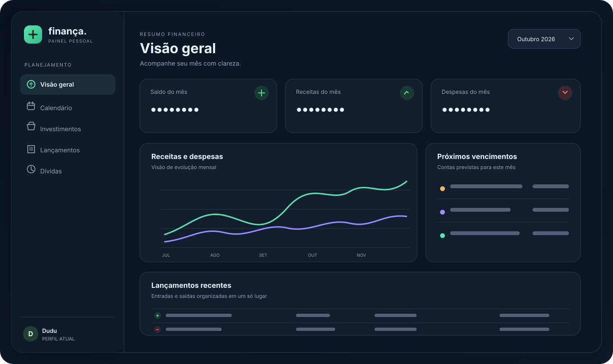

# Finança

Painel financeiro pessoal em português, feito com HTML, CSS e JavaScript. Inclui visão mensal, gráficos, calendário, dívidas parceladas, assinaturas, autenticação Supabase, perfis selecionáveis e backup JSON.

> **Privacidade:** este repositório contém apenas o aplicativo, sem exportações dos seus dados. A imagem abaixo é uma prévia sem saldos ou lançamentos reais.

## Executar localmente

1. Sirva esta pasta por HTTPS ou servidor local, como VS Code Live Server.
2. Abra o endereço servido no navegador. A abertura por `file://` pode impedir a autenticação e as chamadas de rede.
3. Configure o Supabase conforme [`CONFIGURAR-SUPABASE.md`](CONFIGURAR-SUPABASE.md).

## Conteúdo

- `index.html`, `style.css`, `script.js`: aplicação.
- `supabase-config.js`: URL do projeto e chave publicável.
- `supabase-schema.sql`: tabelas, políticas RLS e autorização do usuário.
- `supabase-migration-installment-anchor.sql`: migração para datas de referência das parcelas.
- `CONFIGURAR-SUPABASE.md`: passos de configuração e observações de segurança.

## Publicar

Para publicar como site, use um host HTTPS e configure a URL de retorno correspondente em **Supabase → Authentication → URL Configuration**. GitHub Pages pode hospedar os arquivos estáticos, mas o repositório deve ser privado enquanto não houver revisão adicional e confirmação de que nenhuma informação pessoal foi incluída.

Não envie backups JSON, capturas com valores financeiros, arquivos `.env`, tokens, senhas ou chaves secretas. O `.gitignore` bloqueia os formatos comuns, mas sempre confira a lista de arquivos antes de fazer push.

## Segurança e limites conhecidos

- O `supabase-config.js` contém uma chave publicável `sb_publishable_`, destinada ao cliente web. Chaves `sb_secret_` e `service_role` nunca devem estar no navegador ou no GitHub.
- RLS está habilitado nas tabelas financeiras. O SQL atual autoriza uma conta autenticada na tabela `finance_access` e deixa os dois perfis acessíveis a essa conta. O seletor Dudu/Paloma é uma separação de organização da interface, não uma barreira de autorização: quem entrar com a conta compartilhada pode acessar os dois perfis.
- Edições comuns aguardam a resposta do Supabase e restauram o estado local anterior se o banco não confirmar. A importação tenta preservar os dados existentes até concluir os envios, mas as chamadas REST não formam uma única transação.
- A data de início das parcelas é enviada à coluna `debts.first_due_date`; bancos já existentes precisam da migração `supabase-migration-installment-anchor.sql`. Datas históricas que nunca foram persistidas não podem ser recuperadas automaticamente.
- Bibliotecas e fontes são carregadas de CDNs externos. Uma política CSP e dependências locais com versões fixadas ainda não estão configuradas.
- O código foi revisado manualmente para esta preparação, mas isso não é uma auditoria formal nem teste de penetração.

Se a chave secreta do projeto já foi compartilhada fora do painel Supabase, revogue-a e crie outra antes de usar dados reais.
